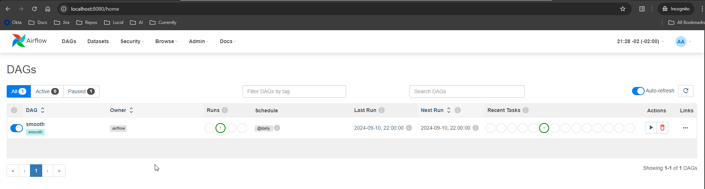

# Wagner Leite - Test

## Troubleshooting

Line 14 - From ``./dag:/opt/airflow/dags`` to ``./dags:/opt/airflow/dags/``

With this, the commands on the airflow-init service are set properly for the right folder.  

---

Line 31 - From ``POSTGRES_USER: admin`` to ``POSTGRES_USER: airflow``

This user needs to match with the user in the parameter `AIRFLOW__DATABASE__SQL_ALCHEMY_CONN`

---

Line 17 - From ``user: "5000"`` to ``"${AIRFLOW_UID}"``

Set a variable to define the user of the system; in this case, the variable is set in the .env file with the specific user.

---

Line 59 - From ``test: ["CMD", "curl", "--fail", "http://localhost:xxxx/health"]
`` to ``test: ["CMD", "curl", "--fail", "http://localhost:8080/health"]``

The port xxxx is not a valid port, changed to 8080.

---

# Smooth Running

